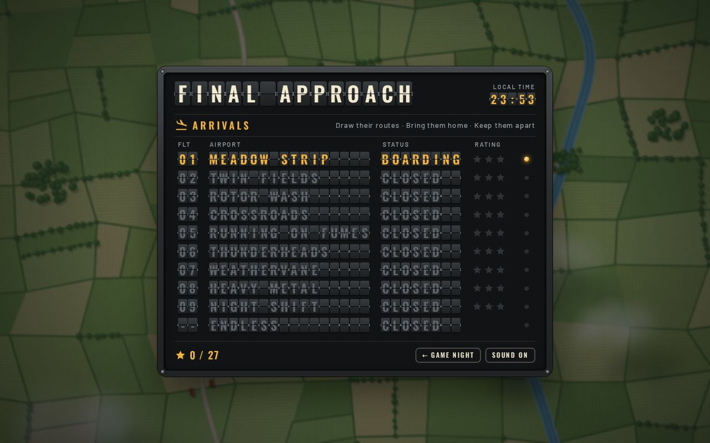
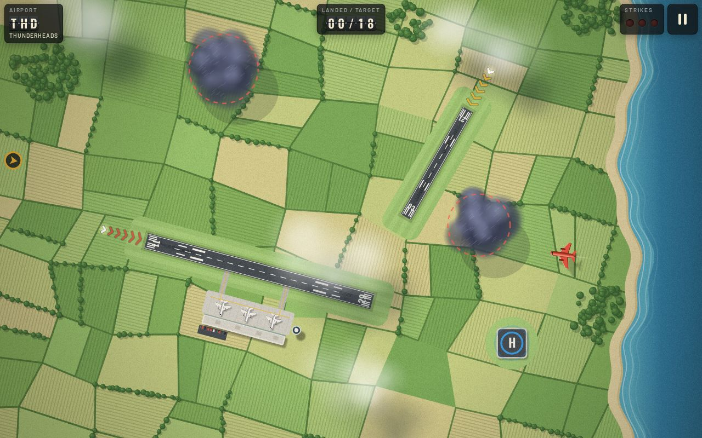
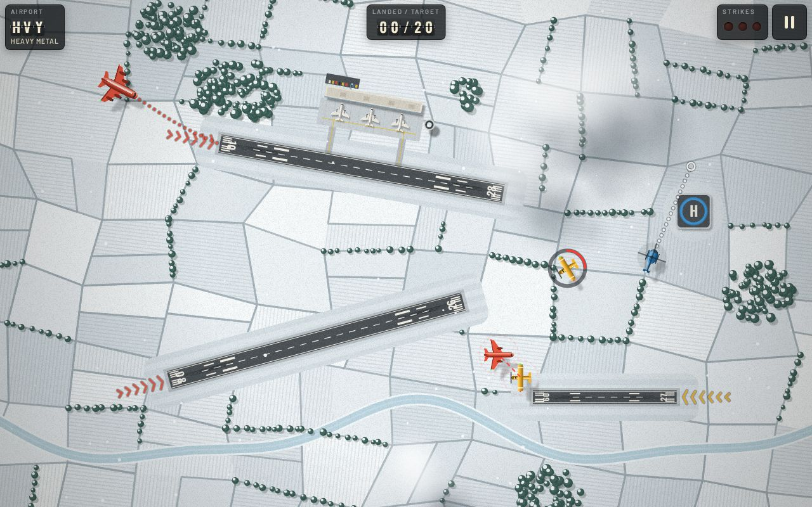
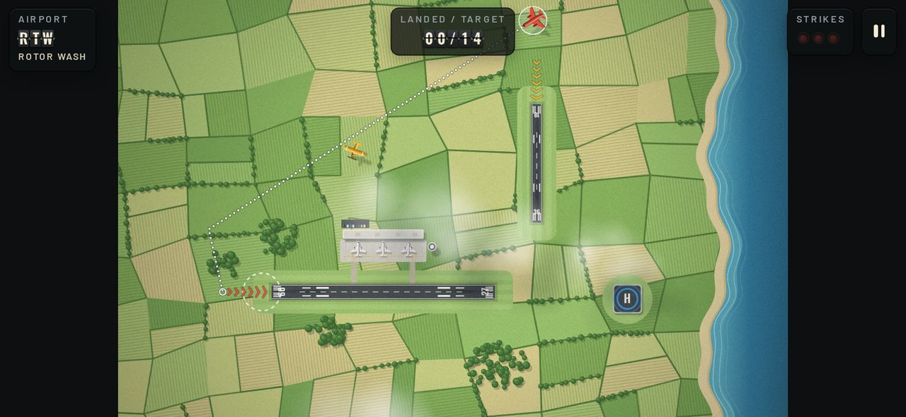
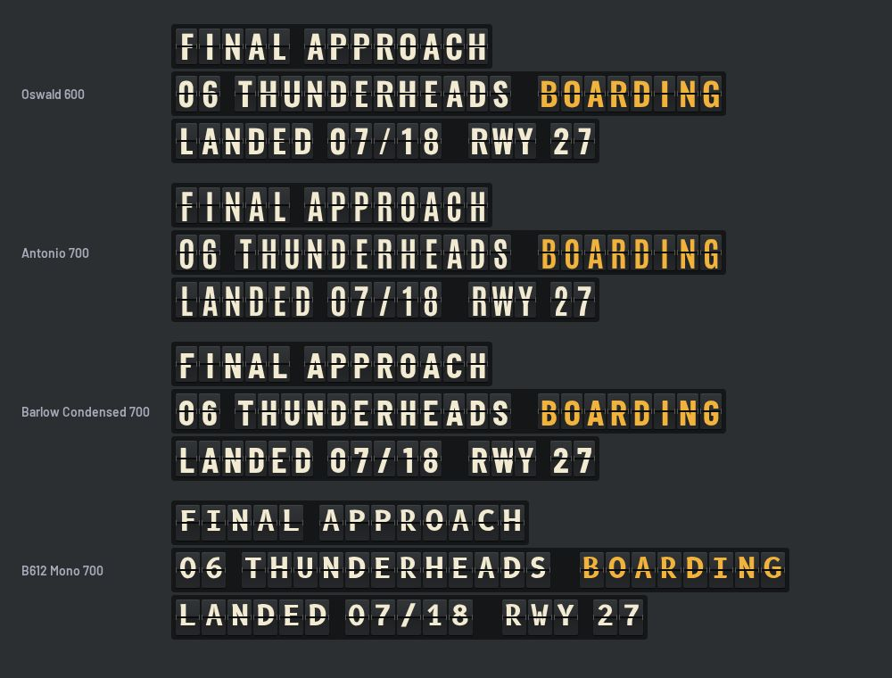
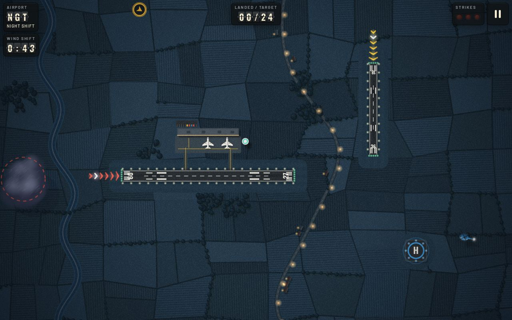

# Final Approach: playbook

What the game is, how it's built, what it wants to be, and how we plan to
get there. Keep it current: when something here stops being true, change
it in the same pull request as the code.



---

## 1. What it is

**Final Approach is a solo air-traffic game.** Aircraft arrive at the edges
of an airport seen from above. Drag from one to draw its route; if the route
ends lined up with the approach lights of a runway in the aircraft's colour,
it lands. Keep everything apart while the traffic builds.

- **The loop:** spot an arrival → draw its route → watch for conflicts →
  redraw → land it → repeat, faster.
- **A session** is one airport: 6 to 24 landings, about three to six
  minutes. Endless mode runs until you fail.
- **Failing:** two aircraft touching is a collision and ends the shift at
  once. An aircraft that runs out of fuel or flies into a storm *diverts*
  (a strike); three strikes end the shift.
- **Progress:** stars per airport for strikes avoided (3 = none), and
  clearing an airport unlocks the next. Endless (the board's last row)
  unlocks after airport 5 and keeps a best score. Section 6 describes the
  bigger structure this grows into: a career, free play and more.

### Where it came from, and what's ours

It's a game in the path-drawing landing genre that some of the early
iPhone hits belonged to. **It is our own game, not a remake of any of
them**: its own name, rules, airports and art. What makes it ours:

- **Runway kinds by colour**: yellow props use the short strip, red jets
  and heavies the long runway, blue helicopters the pad.
- **The lined-up rule**: a route only lands if it comes in along the
  approach lights, not from the side. That makes the angle of approach the
  core skill.
- **Fuel, drifting storm cells, and wind shifts that reverse the runways**
  mid-level, each introduced by its own airport.
- **The look**: a painted mid-century airfield under a split-flap
  departures board, with no image files at all.

Keep it that way: don't borrow another game's names, level layouts or art.



---

## 2. What it wants to be

### The pitch

*The calm-then-frantic pleasure of being a good air-traffic controller, in
a few minutes, on the phone you already have in your hand. It should look
like something you'd frame.*

### Pillars

Every feature should serve at least one of these and harm none.

1. **Readable at a glance.** Colour says where an aircraft goes; the
   approach lights say from which way; a red line says two are too close. A
   new player should land their first plane without reading anything.
   Nothing on screen should need explaining twice.
2. **Calm tension.** Pressure comes from traffic building, not chaos. Every
   failure should feel like *your* mistake, with a visible warning first:
   arrivals are announced two seconds ahead, conflicts flash before they
   collide, the fuel gauge appears long before the tank is dry.
3. **Made with care.** The art is the game's personality: hand-tuned
   palettes, painted fields, runway numbers that are actually right,
   split-flap tiles that really flip. Polish is a feature, not a phase.
4. **Pocket-sized.** Landscape phone first, three-to-six-minute sessions,
   instant resume, works on the LAN with no internet. No accounts, no
   loading screens.
5. **Ours, as a family.** It belongs in Game Night: faces, records and
   friendly rivalry across the family, not strangers' leaderboards.
6. **Skill decides.** Progress gives you options and looks, never power.
   Unlocks widen what you *can* do (a new tool, a new mode, a new paint
   job); none of them make an airport easier than it was designed to be,
   and leaderboards only ever compare runs played under the same rules.

### Not goals

- **A real ATC simulator.** No altitudes, no radio phraseology, no real
  procedures. Real *places* are fine, painted in our style (see World Tour);
  real procedures aren't.
- **Ads, purchases, accounts or third-party anything.**
- **Real-time online multiplayer.** Our servers poll; if we do two
  players, it's on one screen or turn-based (see the roadmap).

---

## 3. How to play (the rules as built)

| Aircraft | Colour | Lands on | Speed (world units/s) | Separation radius |
|---|---|---|---|---|
| Prop | Yellow | Short strip | 30 | 11 |
| Jet | Red | Long runway | 44 | 13 |
| Heavy | Red, bigger | Long runway | 50 | 18 |
| Helicopter | Blue | Helipad, any direction | 24 | 10 |

- **Landing:** the route has to reach a circle (radius 26) just short of
  the active threshold, travelling within about 70° of the runway heading.
  Pads accept any route ending within 24 of the centre.
- **Separation:** aircraft closer than 2.6× their combined radii are in
  conflict (red rings and a dashed red line, plus a beep). Closer than their
  combined radii is a collision.
- **Edges:** an aircraft without a route flies straight and turns back at
  the edge of the map.
- **Fuel:** a gauge ring appears below 40% and flashes red below 15%.
- **Storms:** flying inside 80% of a storm cell's radius diverts the
  aircraft. An arrival never enters on a path that meets a storm in its
  first five seconds of flight (storm movement is predicted exactly), so a
  storm only catches aircraft you've had time to route.
- **Warning:** an arrival's marker shows three seconds ahead on the first
  three airports, two after that.
- **Arrivals never ambush:** an arrival only enters on a path that keeps
  it out of warning distance of every other aircraft for its first five
  seconds (routes and edge turns predicted). If the sky has changed by the
  time it's due, it swings onto a clear heading or waits at the edge, its
  marker full, until one opens.
- **Wind shifts:** five seconds' warning, then every runway reverses. Any
  aircraft on approach to a runway's old end has to go around.
- **Traffic:** the gap between arrivals eases from the airport's start
  value to its end value as you land aircraft (in Endless, over five
  minutes). Each airport caps how many can be in the air at once, and stops
  sending arrivals once enough are inbound to reach the target.
- **Holding** (v1.29.0): every airport has two or three hold fixes, beacons
  near the edges with a three-letter tag (BOV, OCK, LAM, BIG, WIL, TIM: one
  shared pool of names). Let a route go within about 30 units of one and the
  aircraft flies there and circles clockwise, burning fuel, until you draw
  it out again (a tap alone doesn't release it). Up to four stack on a fix,
  each on its own ring (22, 32, 42, 52 units out), turning together a
  quarter turn apart; aircraft in the same stack are at different heights
  and never conflict with each other. State One can't hold. Fixes show from
  Holding Pattern on, and on every airport once it's cleared.
- **Disruptions** (v1.29.0): a runway obstruction (one runway closes for
  20 s while the ops van clears a deer, a dog or a runaway luggage trolley),
  a drone (a 46-unit circle near an approach closes for 30 s; flying into it
  diverts, a strike, as a storm does) and a diversion wave (another airport
  is closed and 3 to 5 extra arrivals come in a burst). Each is announced on
  the board with a countdown first (8 s; 10 s for a wave) and a plate at the
  top left counts down; they come one at a time, never during an emergency
  (emergencies wait for them too, with 8 s' breather either side), never in
  a shift's first 20 seconds. The first of each kind on a device pauses on a
  card that explains it; after that a one-line note under the toast says
  what's happening. Arrivals never spawn into a drone zone, from the moment
  it's announced; a wave's arrivals follow every arrival-safety rule and may
  go past the airport's cap.
- **More disruptions** (v1.30.0), on the same rules (announced with a
  countdown, one at a time, never during an emergency, explained the first
  time):
  - **Hot-air balloons**: one to three drift across in a loose group at 20
    units a second along parallel straight lines, shown dotted with chevrons
    for the 8 s' warning and with a marker counting down where each will come
    in. Each has a 32-unit bubble; flying into one diverts (a strike), as a
    storm does. They take 35 to 60 s to cross and can't be moved. Never at
    dusk or night (Night Shift, the Dusk and Night conditions), in fog or
    with storm cells about; their lines stay clear of the hold stacks.
  - **The air display**: the Kestrels, five jets trailing smoke, cross along
    a straight corridor (68 units wide) shown as a dashed band for the whole
    10 s' warning. They fly at 120 units a second and take 7 to 10 s; an
    aircraft inside the band near the formation as it passes diverts (a
    strike). Behind them the band clears and only the smoke is left. Same
    weather rule as the balloons; the corridor never crosses a hold stack.
  - **The cyber attack** (signed-in grown-ups) or **system gremlin**
    (children's profiles and guests): "Network fault" for 5 s, then for 15 s
    the board scrambles and flips to a ransom note (SYSTEMS LOCKED / PAY 40
    BTC / TO RESTORE; the gremlin's is GREMLIN IN / THE WIRES! / HEE HEE
    HEE). The radar only shows each aircraft where its beam last saw it (a
    full turn a second), so blips jump; everything keeps flying exactly as
    routed. A new route takes 2 s to reach the pilot (it shows dashed,
    "SENDING"), and the aircraft keeps its old route meanwhile. Holding
    **Restore backup** for 3 s ends it early. Input never freezes and no
    aircraft on screen is made up.
  - Arrivals never come in where a balloon will be, nor anywhere near the
    display corridor while it's shown.

### Airports

| # | Code | Airport | Landscape | Target | New idea |
|---|---|---|---|---|---|
| 1 | MDS | Meadow Strip | Meadow | 6 | Drawing routes |
| 2 | TWF | Twin Fields | Meadow | 10 | Jets and colour matching |
| 3 | HLD | Holding Pattern | Meadow | 12 | Hold fixes; runway obstructions (id 12, v1.29.0) |
| 4 | RTW | Rotor Wash | Coast | 14 | Helicopters and pads |
| 5 | XRD | Crossroads | Desert | 16 | Angled runways; drones, hot-air balloons |
| 6 | FUM | Running on Fumes | Meadow | 16 | Low fuel; the air display |
| 7 | THD | Thunderheads | Coast | 18 | Storm cells |
| 8 | WVN | Weathervane | Snow | 18 | Wind shifts reverse runways; diversion waves |
| 9 | HVY | Heavy Metal | Snow | 20 | Heavies, two long runways; runway obstructions, cyber attacks |
| 10 | NGT | Night Shift | Night | 24 | Everything, after dark; runway, drone, wave and cyber disruptions |
| 11 | LFL | Lifeline | Coast | 18 | Emergencies (id 11) |
| ∞ | INF | Endless | Coast | — | Traffic keeps building |

An airport opens once the one before it is cleared, or once it or any
airport after it has been (v1.29.0): inserting Holding Pattern at 3 mustn't
close Rotor Wash to someone who'd already cleared it.



---

## 4. How it's built

### Where it lives

Final Approach is a game in the Game Night hub (`JamesSnaps/ito-app`),
served at `/final-approach/`. Unlike the hub's other games, **it runs
entirely in the browser**: the server's only job is the page.

```
games/final_approach/game.py        blueprint: one route, the GameSpec (accent #e8553f)
games/final_approach/templates/final_approach/play.html   the page: canvas + overlays
templates/art/final-approach.html   the hub tile's drawing
static/final-approach/levels.js     THEMES (landscape palettes) and LEVELS (airports, traffic)
static/final-approach/art.js        Art: terrain painter, aircraft sprites, live layers
static/final-approach/flap.js       Flap: the split-flap display component
static/final-approach/game.js       simulation, input, rendering order, menus, HUD, save, sound
static/final-approach/style.css     the board, boarding pass, HUD; @font-face for the fonts
static/final-approach/fonts/        Oswald (variable) and Barlow 400/500/600, with OFL licences
tests/test_final_approach.py        page, files, no outside URLs, level data shape
docs/final-approach/                this playbook and its screenshots
```

The scripts are plain scripts, loaded in that order, sharing globals
(`THEMES`, `LEVELS`, `Art`, `Flap`). There's no build step, as everywhere in
Game Night.

### Hub integration

- **Its own stylesheet.** The page extends `base.html` (for the manifest,
  icons and home-screen tags) but overrides the `shell_css` block. The
  shared `.btn`, `.row` and `button` rules would otherwise leak into the
  board.
- **A way back.** The board's footer has "← Game Night", because the
  installed web app has no back button.
- **Cache-busting** through the hub's `asset()` helper, like every other
  game.
- **Save data:** `final-approach:save` in localStorage holds
  `{stars: {levelId: 0-3}, best, muted}`. It's per browser.

### The world and the loop

- **A fixed 960×600 world**, scaled to fit and letterboxed. All gameplay
  numbers are in world units. Phones held upright get a "turn sideways"
  overlay and the game pauses.
- **One `requestAnimationFrame` loop**: `update(dt)` (dt capped at 50ms),
  then `render()`.
- **Screens are a state machine**: `menu → brief → play ⇄ pause → ending →
  result`. The simulation only advances in `play`; `ending` lets the last
  landing roll or explosion play out before the result board.
- **An aircraft's states** are `fly → land → gone`, or `fly → divert →
  gone`. A diverted aircraft flies off the nearest edge rather than
  vanishing.
- **Routes** are points 8 units apart, collected from pointer events
  (coalesced events included) and clamped inside the edges. A route
  "locks" the moment a point satisfies the landing rule: the threshold is
  appended and drawing stops.
- **The test hook:** `window.__finalApproach` exposes `{S, LEVELS,
  runwayEnd}` for Playwright.

### Rendering, in layers

1. **Terrain, painted once** per airport and per resize into an offscreen
   canvas at the screen's resolution (capped at 3×). It's seeded by the
   level id, so an airport always looks the same:
   - farmland (a jittered, rotated field grid with crop rows, hedgerows,
     copses) or desert (dune bands, mesas, scrub)
   - sea and beach, a river and a road with farmhouses, placed by searching
     for courses that keep clear of the airport
   - mown airfield grass, then a terminal complex (apron, taxiways,
     terminal, tower, car park, parked aircraft), positioned on whichever
     side of a runway has the most room
   - runways with real designators (heading ÷ 10, so a runway landing east
     is 09 and its other end 27), threshold bars, touchdown and aiming-point
     marks and tyre rubber; pads
   - night lighting baked in, and a film-grain pattern over the lot
2. **Live, every frame**, bottom to top:
   - surf and cloud shadows
   - approach lights: chevrons with a sequenced flash running in to the
     threshold, which brighten with a dashed target ring while you draw a
     matching aircraft
   - aircraft rolling out on the ground, then storm cells
   - routes: round dots that stay put on the ground as the aircraft eats
     the route, in the aircraft's colour once locked
   - contrails, aircraft shadows, then the aircraft themselves with their
     status rings (selected, conflict, fuel)
   - conflict lines and arrival markers
   - clouds, snowfall, effects (text, rings, tyre smoke, explosions) and a
     vignette
3. **Aircraft sprites** are drawn once from vector shapes at 4× and
   stamped. Shadows are blurred silhouettes, using the canvas-shadow trick
   because Safari's canvas `filter` can't be relied on. The parts that
   move (propeller blur, rotors, nav lights and strobes) are drawn live.

### The UI

- **Flap boards** (`flap.js`): each tile is two static halves plus a leaf
  that folds over with the Web Animations API. Tiles step forward through
  the character drum to their target, staggered, with a clack per step,
  capped at a few steps so a board settles in under a second. With
  reduced motion they snap straight to their text.
- **Arrivals board** (the level select): flight number, airport, status
  (CLEARED, BOARDING with a blinking amber lamp, or CLOSED) and rating,
  plus a live clock.
- **Boarding pass** (the briefing): airport code, arrivals to land, the
  hint, the aircraft you'll meet and the runways they need, and a stub with
  the conditions and a per-airport barcode.
- **In-game display:** the airport code, the landed count as a flap
  counter, strike lamps, a wind-shift countdown, and flap toasts.
- **Sound** is synthesised with WebAudio: no audio files.



### Art direction

- **Two references:** a mid-century travel poster (a limited warm palette,
  flat shapes, gentle shading, paper grain) for the world, and a Solari
  split-flap departures board for the interface.
- **Colours:**
  - aircraft: mustard `#f2b632`, vermilion `#e8553f`, cerulean `#3d9be0`
  - interface: board black `#121314`, tile slate, cream `#f3ead2`, amber
    `#f2b33d`
- **Type:** **Oswald** for the flaps and headings, **Barlow** for
  everything else. Oswald was picked over Antonio, Barlow Condensed and
  B612 Mono (the typeface Airbus commissioned for cockpits) because it
  looks most like a real Solari board at phone size. B612 Mono was the
  runner-up on character, but its wide tiles don't fit a phone.
- **No image files.** Everything is drawn in code, so the art scales to any
  screen, costs nothing to download and can't drift between devices.



### How to check a change

1. `.venv/bin/python -m pytest tests -q`: the whole suite, including
   `test_final_approach.py`.
2. Run the hub (`PORT=5055 .venv/bin/python app.py`) and drive
   `/final-approach/` in Playwright at **1280×800** and at **844×390**
   (phone landscape). Screenshot the board, a briefing, and a level after
   about 8 seconds of play. Use `window.__finalApproach.S` to stage scenes:
   park aircraft on final, set up a near miss, run fuel low.
3. Look at the screenshots. Most bugs in this game are visual.
4. Bump `APP_VERSION` and update this playbook.



---

## 5. Current state (v1.30.0)

**Done:**

- [x] Disruptions, part 2: hot-air balloons (Crossroads), the Kestrels'
  air display (Running on Fumes) and the cyber attack, a system gremlin for
  children and guests (Heavy Metal, Night Shift), each announced with a
  countdown and explained the first time; all six kinds in free play's
  Disruptions toggle. Spoken lines and sounds are wired by name, to be
  recorded (v1.30.0)

- [x] Disruptions, part 1: hold fixes on every airport (a shared pool of six
  beacon names), the Holding Pattern teaching airport (third on the board,
  id 12), runway obstructions, drones and diversion waves, each announced
  with a countdown and explained the first time; a Disruptions toggle in
  free play (Off / Some / Lots) once Holding Pattern is cleared (v1.29.0)
- [x] The landscape fills any screen: painted past the airspace (which
  stays 960 × 600 and paints exactly as before), weather over all of it,
  and the edge of the control zone marked with a dashed amber line and the
  airport's code ("THD CONTROL ZONE"); arrivals seen flying in from beyond it
  (v1.28.0)
- [x] Conditions: Dusk, Night, Snow, Storm and Fog on any cleared airport,
  each with its own rule; stamps and the Passport (v1.27.0)
- [x] Who's playing: a browser without a profile is asked once; guests'
  shifts kept anonymously for the owner's Activity page (who, when, how
  far, where people struggle); time and last played on the records
  (v1.26.0)
- [x] Free play on any cleared airport: length, traffic, aircraft, low
  fuel, storms, wind shifts and emergencies, each toggle appearing once its
  airport is taught; tagged on the records, never ranked (v1.25.0)
- [x] Core loop: route drawing, landing rule, separation, fuel, diversions, strikes
- [x] Nine airports plus Endless; stars, unlocks and a best score saved on the device
- [x] Storm cells, wind shifts, five landscapes (meadow, coast, desert, snow, night)
- [x] Painted terrain, airport complexes, approach lights, shaded aircraft, weather effects
- [x] Arrivals board, boarding pass, flap HUD and toasts, synthesised sound
- [x] Part of the Game Night hub, with a tile, tests and docs
- [x] Carry on a route from its end; bigger arrival markers with a countdown,
  never under the HUD; three seconds' warning early on; storm-safe arrivals
  (v1.19.0)
- [x] Emergencies, the grown-up set and kids' profiles: bird strike, engine
  fire, decompression, gear failure, hydraulic failure, unruly passenger,
  for grown-ups' profiles only; the Family page behind the Authelia login
  marks children's profiles (v1.24.0)
- [x] Emergencies, the everyone set: fuel, medical, air ambulance, damaged,
  State One; the Lifeline airport; Endless with Off / Some / Lots and a
  board for each; medals (v1.23.0)
- [x] Family records: shifts recorded against your Game Night profile, an
  Endless leaderboard with faces, stars per airport for everyone, progress
  that follows your profile (v1.22.0)
- [x] Settings: volumes, large aircraft, vibration, calm skies; runway-kind
  shapes; a ghost finger on the first airport (v1.22.0)
- [x] Arrivals can't fly into traffic in their first five seconds (v1.21.1)
- [x] Spoken radio dialogue, and varied, fading touchdowns (v1.21.0)
- [x] Recorded sound and music (v1.20.0): touchdowns, chimes, radio, the
  flap board, a background per landscape, engines that follow the traffic,
  and three music tracks that turn busy as the sky fills. Made with
  ElevenLabs, bundled; the alert and fallbacks stay synthesised.

**First family play** (31 October 2026): James and Louis played it and
think it's great. Their requests are in Phase 3; the first ones shipped in
v1.19.0. Later that day they found an arrival could appear and fly straight
into an aircraft already on screen, ending the game; fixed in v1.21.1. They also found that a storm could sit where an arrival came in
and divert it instantly, which broke the "always a warning" pillar. Fixed
in v1.19.0.

**Known rough edges:**

- **Balance hasn't been played by hand.** Traffic intervals, fuel and
  storm speeds are first guesses; tune them by playing.
- **Not yet tried on a real phone.** Touch has only been tested in an
  emulated browser. Check the drawing feel, frame rate on an older phone,
  and the tile flips' cost on the board.
- **Progress without a profile is still per browser.** With one, it
  follows you (v1.22.0).
- **Vibration only works on Android**; iPhones' browsers don't allow it.
- **The iOS app doesn't show it**; it's web only (Phase 12).
- **Repainting the terrain on resize** takes a beat on slow devices
  (debounced, but noticeable when rotating).

---

## 6. The full game we're building towards

Today it's eleven airports and Endless. This is the shape we're growing it
into. The roadmap (section 7) is the order we'll build it in.

### Modes

| Mode | What it is | Who sets the rules |
|---|---|---|
| **Career** | The main way to play: chapters of airports, ranks, checkrides, tools and cosmetics | The designer. An airport's rules are part of its design and teach one idea at a time. |
| **Free play** | Any airport you've cleared, played your way: a short shift or endless | You, with toggles (below) |
| **Endless** | Traffic builds until you fail; ranked, with a best score | Fixed, so the leaderboard compares like with like |
| **Daily approach** | One seeded run per day, the same for the whole family; one try counts | Fixed per day |
| **Together** | Two in the tower, or a tower view on the TV | Per game |

**Free play's toggles:**
- departures
- fuel
- storms
- wind shifts
- changing weather
- emergencies (off, occasional or frequent)
- traffic (light, normal or rush)
- conditions (day, dusk, night, snow, storm)

**A toggle only appears once the career has taught that feature**, so free
play never springs an unexplained rule on you. Replaying a cleared airport
under harder conditions earns extra stars.

**Records keep settings apart.** A free-play run with custom toggles is
recorded with its settings and shown separately, the way Fugitive marks
"no hints" games. It's never mixed into Endless or the daily leaderboard.

### Career

- **You are a controller, and your character is your Game Night profile.**
  Your name and selfie go on a controller's licence card, which replaces the
  boarding pass as the career's briefing screen.
- **Customising is cosmetic only.** Earn and choose:
  - the ink colour of your flap board: amber, white or green
  - your tower's name, shown on the board
  - your terminal's roof and paint scheme
  - a livery for the aircraft parked at your stands and for your departures

  The aircraft colours that tell you which runway to use are never
  customisable.
- **Chapters**, each a handful of airports teaching one idea, ending in a
  **checkride**: a harder exam airport. Passing promotes you: Trainee →
  Ground → Tower → Approach → Senior → Chief controller. Today's nine
  airports become the first chapters:
  1. **Countryside:** routes, jets, helicopters (airports 1–3)
  2. **Wide open:** angled runways, low fuel (4–5)
  3. **Weather:** storms, wind shifts, then weather that changes (6–7, plus new)
  4. **Big airports:** heavies, departures, two runways, wake turbulence (8, plus new)
  5. **Night and winter operations:** after dark, runway closures (9, plus new)
  6. **At sea:** carriers
  7. **World Tour:** real airports
- **Experience** from every movement and star unlocks cosmetics. Rank only
  comes from checkrides, so rank always means skill.
- **Tools are the "skills".** Each promotion earns a tool. Before a shift you
  take two (your loadout), each with a few charges:
  - **Hold:** draw a loop to park an aircraft in a holding circle
  - **Slow down:** tap an aircraft to fly at 70% speed for a few seconds
  - **Ground stop:** no new arrivals for ten seconds
  - **Radar sweep:** see where the next three arrivals will enter
  - **Priority release:** send a waiting departure straight to the runway

  Tools add choices, not power. Every airport is balanced to be clearable
  with no tools at all, and ranked Endless and the daily run use no tools,
  or one fixed loadout for everyone.
- **Career progress is kept against your profile on the server**, so it
  follows you to any device. Without a profile it's kept on the device, as
  today.

### Assists and tools

Two different things that sit side by side (decided 31 October 2026):

| | **Assists** (calm skies, and any future ones) | **Tools** (the career's "skills") |
|---|---|---|
| What it is | Changes the *conditions* to make the game kinder | Something you *do* in the moment |
| How you get it | There from the start, in Settings | Earned through career promotions |
| How it works | Applies to the whole shift; nothing to press | Two chosen per shift, a few charges each |
| Who it's for | A player who's overwhelmed | A player getting good, wanting more ways to solve the sky |
| On the records | Marked; earns your stars; never ranked | Part of the career game; career shifts count normally |

- **They stack:** calm skies with your tools is fine.
- **One rule for both:** anything that changes the challenge is marked, and
  only like-for-like runs are ranked against each other. Ranked Endless and
  the daily run use no tools (or one fixed loadout for everyone), and
  assisted runs are kept off the ranked boards.
- **Future assists join calm skies under "Assists" in Settings**, not the
  tools: longer arrival warnings, a lower traffic cap and the like, all
  marked and never ranked.
- **For younger players, the first tool comes early.** Calm skies gives
  time; tools like Hold and Slow down give *a move to make* when it gets
  busy, which is what helps with panic. So the career hands out Hold in its
  first chapter, not after several promotions.

### New mechanics

Each one arrives with an airport that teaches it, and then joins free play
as a toggle.

- **Departures.** The runway becomes a shared resource: slotting a departure
  into a gap in the arrivals is the heart of real air-traffic control.
  1. An aircraft at a terminal stand flashes "ready", announced ahead of
     time like an arrival.
  2. Tap it to release it. It taxis by itself to the holding line.
  3. Tap it again to clear it for takeoff. Timing this is the skill.
  4. It rolls, lifts off into the wind (so wind shifts reverse departures
     too) and climbs out. At first it flies straight off the map; later you
     route it to a lettered exit gate.

  A landing while a departure is still on the runway is a collision. A
  departure left waiting too long is a delay strike. The target becomes
  *movements* (landings plus departures). Introduce it with helicopters
  lifting off the pad first, then one runway, then separate arrival and
  departure runways, then exit gates.
- **Weather that changes** (Phase 7): building storms, fog banks, crosswind
  gusts, dusk turning to night, snow closing a runway while a plough clears
  it.
- **Wake turbulence:** nothing lands close behind a superjumbo on the same
  runway, so the order of landings matters.
- **Holding patterns** ✅ (v1.29.0): hold fixes on the map, not a tool (see
  "Disruptions" in the roadmap and section 3).
- **Moving runways:** a carrier's deck sails and turns.
- **Mountains** (added 1 November 2026). High ground is a fixed no-fly
  area, like a storm that doesn't move. An aircraft that flies into it pulls
  up and diverts ("Terrain! Pull up"): a strike, as a storm is. A route
  drawn across it shows red as you draw. The arrival safety rules that keep
  new arrivals out of storms for their first five seconds cover terrain
  too, so it never springs on anyone.
  - **The puzzle is the valley:** a runway between ridges can only be
    reached along the valley, so approaches have to be planned from further
    out, like the real Innsbruck, Paro or Queenstown.
  - **The look:** a mountain landscape painted like the others, in code:
    shaded relief, contour lines, snow on the peaks, a lake or two. With the
    landscape now painted past the airspace (v1.28.0), the range carries on
    beyond the control zone.
  - **The map is big enough:** two storm cells fit comfortably today, so a
    ridge, or two or three peaks, will too.
  - **Introduced by** a teaching airport in a mountain landscape (a "High
    Pass"), then in later airports, free play and World Tour (Innsbruck is
    an obvious real one).

### Radio dialogue ✅ (v1.21.0)

Pilots talk to you, the tower, in plain English, the way they do on a real
frequency but short and friendly. Built as described here: 85 lines, eleven
voices (British, Australian, Irish and American pilots; one British voice
for the tower), about 1 MB. The table's "Emergencies" row waits for the
emergencies themselves.

- **Recorded with ElevenLabs text-to-speech** in a handful of voices and
  accents (British, American, Australian, Irish and others), generated once
  by `tools/final_approach_sounds.py` like everything else. Each line is its
  own small file; the generator holds the script.
- **Made to sound like a radio live:** the clean voice goes through a
  band-pass filter and a little crackle, with a squelch click before and
  after, so one recording works on any radio sound we want.
- **What they say:**

  | When | Who | For example |
  |---|---|---|
  | A route locks onto a runway | Pilot | "Cleared to land, runway two seven." (the real number of the runway end in use, one set of lines per number) |
  | A route locks onto a pad | Pilot | "Pad in sight, coming in." |
  | A route is redrawn (sometimes) | Pilot | "Copy, new heading." "Wilco." |
  | Fuel drops below 40% | Pilot | "Tower, we're getting low on fuel." |
  | Fuel drops below 15% | Pilot | "Mayday, minimum fuel, we need to land now." |
  | An aircraft diverts | Pilot | "Diverting to our alternate." "Too rough in that cell, we're out." |
  | A wind shift sends it round | Pilot | "Going around." |
  | After landing (sometimes) | Pilot | "Thanks, tower. Lovely evening for it." |
  | Before and after a wind shift | Tower (you, on the speaker) | "All aircraft, wind change, runways reversing." |
  | Emergencies (below) | Pilot | "Pan-pan, pan-pan, medical emergency on board." |

- **Rules, so it stays a treat:** one call at a time, a few seconds' quiet
  after each, lines dealt like a shuffled deck so none repeats until all
  have played, and some events only speak sometimes. Music and the
  background dip a little under speech.
- **Callsigns are made up** ("Skylark 12", "Puffin 4"), never real
  airlines'. Most lines don't need one.

### Emergencies

Suggested at the first listen (31 October 2026); the everyone set built in
v1.23.0. Now and then an aircraft arrives with an emergency and has to come
first.

**As built (v1.23.0), for everyone:**

| Emergency | How it plays |
|---|---|
| **Fuel** (mayday) | Arrives on 30% fuel, its gauge showing from the start. |
| **Medical** (pan-pan) | A 45-second countdown ring; land it on any of its usual runways in time, or it diverts. |
| **Air ambulance** (pan-pan) | A helicopter with a 38-second countdown, racing for the pad. |
| **Damaged** (mayday) | Trails smoke, flies at 70% and can't turn sharply (0.9 rad/s): tight routes overshoot, and it goes around if it misses the runway or reaches it not lined up. It needs a long, straight final. Long runway only; after it lands, fire engines close that runway for 8 seconds and anyone on approach to it goes around. |
| **State One** (the president's plane) | A heavy with a gold no-go bubble (70 units): an aircraft flying into it is turned away by security, a strike. Long runway only. |

- **How you know:** 3.5 seconds' warning with a flashing red-and-white
  marker, an alert tone, the flap board ("MAYDAY · FUEL", "PAN-PAN ·
  MEDICAL", "STATE ONE"), the pilot's call (and the tower's, for State One);
  in the air, red-and-white strobes, the countdown or "MAYDAY" above it.
- **Stakes:** landing one earns a **medal** (on the result, the records and
  each recent shift); losing one costs **two strikes**.
- **Where:** **Lifeline**, a teaching airport after Night Shift (long
  runway, short strip, helipad; an emergency every 22–36 seconds), and
  **Endless**, whose boarding pass offers emergencies **Off, Some or Lots**
  (`save.emergencies`, Some by default). Each setting has its own Endless
  leaderboard, so a board is always like-for-like; bests from before
  emergencies count as Off. Free play gets the same switch when it exists.
- **Rules:** one at a time, never two at once, never in a shift's first
  seconds; arrivals are kept clear of State One's bubble as they're of
  other traffic.

**Step 2 (built in v1.24.0): kids' profiles and the grown-up set.** As
designed below, with these details: bird strike happens only to an aircraft
well clear of everyone (the surprise is the emergency, not a collision);
fire 35s and a 14s closure; decompression 30s, 130% speed, flying low; gear
failure's route reserves the runway with foam as soon as it locks on, and
anyone else on approach goes around; hydraulic failure turns at 0.45 rad/s;
unruly passenger 40s, police meet it. Grown-ups can switch the set off in
Settings ("Grown-up emergencies"). Endless runs with them rank on their own
boards. The Family page needs the docker repo's rules live (Traefik and
Authelia); until then it refuses, never opens.

- **A kid's profile, safe enough for a family.** A **Family** page behind
  the Authelia sign-in (so only a signed-in grown-up can use it) marks a
  Game Night profile as a child's. The game reads the mark from the
  profile; kids' profiles **and guests** get only the everyone set, so
  signing out isn't a way round it. Grown-up emergencies appear only for a
  signed-in adult profile. The gap: a child playing on a parent's
  signed-in phone gets the parent's set, which is fine for a family. This
  touches the hub's profiles (a `kid` flag and the protected page) and
  needs the page's route adding to the Authelia rule in the docker repo,
  live before the page is used.
- **The grown-up set:**

  | Emergency | How it would play |
  |---|---|
  | **Bird strike** | An aircraft *already flying* loses an engine: no warning, slower, mayday. The surprise is why it's grown-up. |
  | **Engine fire** | Smoke and flames; must land within a short time; the runway closes longer while crews work. |
  | **Cabin depressurisation** | Drops fast: an oxygen-mask call, a burst of speed, then it needs the nearest runway. |
  | **Landing-gear failure** | A belly landing on the long runway: foam goes down first, closing it before and after. |
  | **Hydraulic failure** | Barely steerable: very wide turns, a long straight final. |
  | **Unruly passenger** | Must land as soon as possible; police meet it on the apron. |

- **Not included:** hijacks and bomb threats. Even for grown-ups, that's
  not a tone that fits a family hub.

### The aircraft roster

| Aircraft | Lands on | What it adds |
|---|---|---|
| Prop, Jet, Heavy, Helicopter | Short, long, long, pad | Today's four |
| Regional turboprop | **Either** strip | The first runway *choice*; two-tone so it reads as "either" |
| Business jet | Short strip | Fast among the slow props |
| Superjumbo | Long runway | Big, and wake turbulence behind it |
| Supersonic | Long runway | Very fast and always low on fuel: route it first |
| Glider | Short strip | No power, so it can't go around: its first route is final |
| Seaplane | A water lane | Lands on the sea at coastal airports |
| Emergency | Its usual runway (damaged: long only) | Medical, damaged, fuel or state flight; see "Emergencies" |
| Carrier fighter | Carrier deck | Short touchdown zone; only at sea |

Every aircraft is a generic design: no real airlines' liveries or
trademarked shapes.

### Airports and places

- **Fictional airports** for each chapter, as today.
- **At sea:** carriers are their own levels, not a theme to choose. A theme
  is a paint job over a fixed layout; a carrier *is* the layout (one short
  deck that moves, with sea all around). They appear in three ways:
  - **the At sea chapter**, one idea per level: a steady course, a turning
    carrier, a carrier group with a destroyer's helipad and ships to route
    around, and night deck operations
  - **offshore in later coastal airports**, an extra moving runway only
    fighters use
  - **a carrier Endless mode**
- **World Tour: real airports from OpenStreetMap data**, painted in our
  style:
  - a developer-side script (not part of the game) turns an airport's map
    data into a level file: runways with their real numbers and headings,
    taxiways, terminals, and the coastline, rivers and roads around them
  - we hand-tune the traffic
  - famous tricky airports (a road crossing the runway at Gibraltar, the
    beach runway at Barra, Saba's very short strip), plus the airports the
    family actually flies from
  - the game credits "© OpenStreetMap contributors", and the extracted
    level data is published under OpenStreetMap's open data licence (ODbL)

  **No satellite imagery:** the major providers' terms forbid using it this
  way, free imagery is too coarse, live tiles would break the no-internet
  rule, and photos would clash with the art.

---

## 7. Roadmap

In order, but it can change. Each phase is one or more pull requests with
its own version bump. "Done when" is the bar for ticking it off.

**The order now** (31 October 2026): Phase 5 (free play, then conditions
and the Passport), then **Disruptions** (after Phase 5), then Phase 4
(departures), then on from Phase 6. Phase 5 is done, and Disruptions
part 1 (holding, obstructions, drones, diversion waves) shipped in v1.29.0
and part 2 (balloons, the air display, the cyber attack) in v1.30.0; what's
left of Disruptions (Endless's choice, runway lights, Santa) is small and
can come around Phase 4.

### Phase 1: in the hub ✅ (v1.18.0)

Moved from a standalone prototype into Game Night, with the tile, tests,
docs and this playbook.

### Phase 2: records and faces ✅ (v1.22.0)

The family leaderboard is the reason to be in Game Night, and the
groundwork for career progress following your profile. Built as below,
except that the arrivals board shows the family's Endless best (with a
face) beside yours, rather than a face per airport.

- Post a finished shift to `POST /final-approach/api/stats/games`, keyed by
  the device's profile name (`GN.me`): `{level, landed, strikes, stars,
  duration}`, and Endless runs `{landed, duration}`. No profile means no
  record, the same as guests elsewhere.
- Validate on the server (sane bounds: landed ≤ what the airport's target
  and time allow, duration ≥ a floor), as Flip 7 does. This isn't real
  anti-cheat, just protection from bugs and bored guests.
- A records page at `/final-approach/stats`: an Endless leaderboard with
  faces, stars per airport per person, recent shifts. Link it from the
  board.
- Stars and unlocks are also saved against the profile, so a second device
  picks up where the first left off.
- **Done when:** two profiles on two devices see each other's Endless bests
  on the board, and a profile's stars appear on a second device.

### Phase 3: feel, sound and balance

**First family play** (31 October 2026, James and Louis): "we think it's
great". They asked for bigger markers for incoming aircraft, music,
better sound effects to match the visuals, and a way to carry on a route
instead of starting it again. All four are here.

**First listen** (31 October 2026, after v1.20.0 went live): "first
impressions are good", but:
1. the radio acknowledgements repeat too often and get repetitive; they
   want far more of them, in actual English
2. the landing sounds repeat too, and start and stop abruptly
3. pilots should talk about things like low fuel

All fixed in v1.21.0: three touchdown recordings per aircraft family,
dealt so none repeats until all have played, with every sound fading in
and out and a landing straight after another played quieter; and spoken
radio dialogue (section 6, "Radio dialogue") in place of the garbled clips,
rationed to one call at a time.

**Controls**

- ✅ **Carry on a route from its end** (v1.19.0). Touching the end of an aircraft's
  unfinished route (the white ring) continues that route; touching the
  aircraft still starts a fresh one, exactly as now. Fixing a route
  shouldn't mean redrawing all of it.
  - The end ring becomes a proper handle: bigger, and pulsing gently while
    it can be grabbed.
  - A touch goes to whichever is nearest, an aircraft or a route end. A
    tie goes to the aircraft, so the gesture everyone already knows never
    changes meaning.
  - Only unfinished routes have a handle. A route already locked onto a
    runway has none; to change it, start again from the aircraft.
  - It's small: a second kind of touch target in `pointerdown`, and
    `extendRoute` starting from the route's last point instead of the
    aircraft. About 30 lines, plus a staged scene to check it.
- ✅ **Teach without words on airport 1:** a ghost finger drawing the first
  route, until the first landing.
- ✅ **Haptics** (`navigator.vibrate` where there is one) on conflict, lock
  and divert.

**Seeing what's coming**

- ✅ **Bigger arrival markers** (v1.19.0). An arrival was a small circle
  (radius 11) with a chevron, two seconds ahead. Now it's:
  - at least 30 CSS pixels across on any screen, sized from `view.scale`
    rather than fixed world units, so it reads on a phone
  - the arriving aircraft's own silhouette in its colour, pointing the way
    it will fly, instead of a chevron
  - ringed by a band that fills over the warning, so you can see *when* it
    arrives, not just where
  - three seconds' warning on the first airports, two later
  - never under the HUD's plates (those stretches of the top edge are off
    limits)
- ✅ **A "large aircraft" setting** that draws aircraft 25% bigger on phones.
  Drawing only: separation distances stay the same, so the game doesn't
  get harder or easier.
- ✅ **Shapes as well as colours:** a small runway-kind glyph on each
  aircraft's arrival marker and on the runway's end (▲ short, ■ long, ● pad),
  so colour is never the only cue.

**Sound** ✅ (v1.20.0; see "As built" below)

The aim: sound that matches the art, warm, mid-century, never shrill.

- **An airfield bed per landscape,** quiet and looping: wind and birdsong
  in the meadow, surf on the coast, a dry wind in the desert, muffled wind
  in the snow, crickets at night.
- **Aircraft you can hear:** a soft engine for each type (the prop's buzz,
  a jet's whoosh, the heavy's rumble, the rotor's thud), panned left or
  right with the aircraft's position and mixed down as traffic grows.
- **Moments:**
  - a radio click and a few garbled syllables of "controller" when a route
    locks onto a runway
  - a tyre chirp and a reverse-thrust roar at touchdown
  - an airport chime when a shift starts, and again when it's cleared
  - a two-tone traffic alert for a conflict, replacing the beep
  - a deeper boom for a collision, and radio static as an aircraft diverts
- **The flap board** gets a better clack: a short wooden tick, and a rattle
  when many tiles turn at once.
- **Where the sounds come from** (to decide; see open questions):
  - **Synthesised live** (WebAudio, as in the rest of Game Night) for
    anything that has to vary as you play: engines panned with each
    aircraft, the flap board, radio garble, alerts. Nothing to licence or
    download.
  - **Generated once, then bundled**, for the set pieces where realism
    matters: touchdown, the airport chime, the landscape beds (ElevenLabs'
    sound-effects generator), and two or three music tracks (Suno), such as
    a board theme, a calm shift and a busy shift, cross-faded by traffic.
    Generated on a developer's machine, saved as small AAC/MP3 files under
    `static/final-approach/audio/`, and loaded from our own server, so the
    no-internet rule holds. **Never called from the game at runtime**: that
    would put an API key in every browser and a third party in every shift.
    Licences need checking against the plan used: free tiers are
    non-commercial with conditions, and paid tiers give ownership. The repo
    is public, so bundled files are effectively published.
  - **Not** `Citedy/game-sounds` (suggested 31 October 2026): the code is
    MIT-licensed but the sounds are clips from copyrighted games and films,
    which nobody can license to us, and it would break "our own game".
  - A small bundled public-domain (CC0) sample stays the fallback for any
    single sound neither approach gets right.

**As built (v1.20.0).** 26 recorded sounds made with ElevenLabs and
bundled (about 4 MB), each prompt kept in `tools/final_approach_sounds.py`
so any sound can be remade by changing its wording:

| Group | Sounds |
|---|---|
| Moments | touchdown (jet, prop, helicopter), shift start, cleared and failed chimes, collision, divert, three radio calls (one plays when a route locks), wind shift |
| Flap board | two single clacks (one plays per tile step, pitch varied) and a rattle when the board opens |
| Beds (20 s loops) | meadow, coast, desert, snow, night |
| Engines (10 s loops) | jet (jets and heavies), prop, helicopter: one loop per family, louder with more aircraft, panned to where they are |
| Music | a board theme (60 s), a calm shift and a busy shift (90 s each), in 1960s jet-age lounge jazz |

The conflict alert is still synthesised (a two-tone that repeats), and the
old synth sounds are the fallback while a file loads. Music is on by
default, with its own toggle on the board beside Sound. Still to come: a
separate volume control for each group, in the settings sheet.

**Music** ✅ (v1.20.0, as above; the original brief follows)

- A lounge score in the travel-poster spirit: Rhodes or vibraphone chords,
  a walking bass, brushed drums.
- **It follows the traffic:** sparse with one or two aircraft, fuller and a
  little quicker as the sky fills, a tense layer while two aircraft are in
  conflict, and a resolving phrase when a shift is cleared. The board gets
  its own calmer version.
- Separate volumes for music and sound effects.

**Radio dialogue** ✅ (v1.21.0; section 6): 85 spoken English lines in
eleven voices for locks (with the real runway number), pads, redrawn
routes, low fuel and maydays, diverts, go-arounds, thanks after landing,
and the tower opening and closing the shift and calling wind shifts.

**Balance and settings**

- Play every airport by hand on a phone and tune `traffic` per airport.
  Record the numbers here.
- ✅ A settings sheet (v1.22.0): sound, effects/voices/music volumes,
  large aircraft, vibration, calm skies. A left-handed HUD is still to do.

**Louis and the difficulty curve** (31 October 2026): he loves it but
panics when it gets busy. The curve stays (it's the game), but calm skies
(v1.22.0) is an honest assist: three-quarter speed and calm music, his own
stars still earned, his shifts marked "calm skies" on the records and never
ranked. The early airports are there to replay for confidence.

**Done when:**
- someone new lands their first plane without help
- Louis can see every arrival coming, on a phone
- you can follow a shift by ear alone
- it holds 60fps on the family's oldest phone

### Phase 4: departures

The first big new mechanic (section 6).

- Aircraft gain ground states: parked, taxiing, holding, rolling and
  climbing, before flying as usual.
- The taxi routes the terrain painter already works out (`placeComplex` in
  `art.js`) move into the level data, so the painter and the game share one
  set of geometry.
- Helipad departures first, then one teaching airport, then departures
  added to later airports.
- **Done when:** a teaching airport and two existing airports run arrivals
  and departures together, and a runway incursion is impossible to miss.

### Phase 5: free play and conditions ✅ (v1.25.0, v1.27.0)

Planned 31 October 2026. Two parts, built and shipped in this order:
free play first (it's the "try out different options" part, and it needs
no new art), then conditions.

**The split.** Conditions are *fixed* harder versions of an airport, so
they're comparable and earn something. Free play is *your* rules, so it
earns nothing and is never ranked: it's for trying things out.

| | Conditions | Free play |
|---|---|---|
| What | Replay a cleared airport at dusk, at night, in snow or in a storm | Any cleared airport with your own toggles, as a shift or endless |
| Rules | Fixed per condition | Yours |
| Earns | A stamp per condition, 1 to 3 stars like a shift | Nothing; recorded and shown as "free play" |
| Ranked | Shown on the records grid | Never |
| Calm skies | Allowed, marked as now | Allowed, marked as now |

#### Part A: free play ✅ (v1.25.0)

**Where it lives.** A cleared airport's boarding pass gets a second button
beside Board: **Free play**. It opens a sheet like Settings, with the
toggles below and a Start button. The last choices are remembered per
device. The board row for a cleared airport is unchanged; free play is
always one tap further in, so the career path stays the obvious one.

**The toggles.** Each appears only once the airport that teaches it has
been cleared (section 6: free play never springs an unexplained rule):

| Toggle | Values | Taught by | How it's built |
|---|---|---|---|
| Length | Shift (the airport's target) · Endless | always | Endless reuses the INF rules: no target, traffic eases over five minutes |
| Traffic | Light · Normal · Rush | always | Light: arrival gaps ×1.35, one fewer in the air. Rush: gaps ×0.75, two more |
| Aircraft | the airport's own mix, plus each type you've met | Twin Fields (jets), Rotor Wash (helicopters), Heavy Metal (heavies) | A type only spawns if the airport has somewhere it can land |
| Low fuel | Off · On | Running on Fumes | Arrivals carry FUM's 45 seconds |
| Storms | Off · 1 · 2 · 3 | Thunderheads | `makeStorm`, as now; the storm-safe arrival rules already cover any count |
| Wind shifts | Off · On | Weathervane | Every 45 seconds |
| Emergencies | Off · Some · Lots | Lifeline | Endless's control and rules, grown-up set included for adult profiles |

Every toggle starts at the airport's own setting, so opening the sheet and
pressing Start plays the normal airport with no stars at stake.

**How it's built.** Free play doesn't add special cases to the game loop.
`freePlayLevel(L, choices)` returns a new level object built from the
airport and the toggles (traffic, `storms`, `windShift`, `emergencies`,
`endless`), and `loadLevel` runs it like any other. The id stays the
airport's id, so the painted terrain and runways are the same, and
`S.mode = 'free'` stops `finish()` awarding stars or Endless bests.

**Records.** A free-play shift is sent with its settings (`free`). The server checks every setting against a fixed list, keeps the
shift in Recent shifts with a "free play" tag and a one-line summary
("Rush · 2 storms · endless"), and counts it towards shifts and landed, but
never stars, Endless boards or medals.

**Done when:** every cleared airport can be played your way; a toggle you
haven't been taught never shows; a free-play run never changes stars or a
leaderboard.

#### Part B: conditions ✅ (v1.27.0)

**What each condition is.** Each changes how the airport looks *and* one
rule about how it plays, so a stamp means something. Everything else (the
target, the aircraft, the runways) is the airport as you cleared it.

| Condition | Looks | Plays | Why it's fair |
|---|---|---|---|
| **Dusk** | The light fades through the shift: day at the start, golden light in the middle, night by the last few landings, with runway, building and aircraft lights coming on | **Evening rush:** in the last third of the shift, arrivals come 20% closer together | You can see it coming: the sky darkens as the rush builds |
| **Night** | The airport's own landscape after dark, as on Night Shift | **Seen late:** arrival markers show one second later than usual | The marker still always shows before an aircraft appears |
| **Snow** | The landscape under snow, snow falling, runways edged with ploughed snow | **Icy runways:** an approach must be lined up within 45° of the runway (70° normally) or the aircraft goes around | The approach lights show the line; a go-around isn't a strike |
| **Storm** | A dark sky, rain, lightning | **Storm cells:** at least two, and one more than the airport normally has | The storm-safe arrival rules already guarantee no arrival is spawned into one |
| **Fog** | A pale wash over the landscape, thicker at the edges; approach lights glowing through it | **Low-visibility approaches:** an aircraft has to fly its last stretch straight in, lined up with the runway, for twice as long as usual before it can land, or it goes around | The approach lights show exactly where the straight-in line starts |

**Which airports offer which.** Every airport except Endless, but only
the conditions that differ from how it already is:

| Airport | Dusk | Night | Snow | Storm | Fog |
|---|---|---|---|---|---|
| Meadow Strip, Twin Fields, Rotor Wash, Running on Fumes, Lifeline | ✓ | ✓ | ✓ | ✓ (2 cells) | ✓ |
| Crossroads (desert: no snow) | ✓ | ✓ | | ✓ (2) | ✓ |
| Thunderheads | ✓ | ✓ | ✓ | ✓ (3) | ✓ |
| Weathervane, Heavy Metal (already snow) | ✓ | ✓ | | ✓ (2) | ✓ |
| Night Shift (already night) | | | ✓ | ✓ (2) | ✓ |

Fog (added 31 October 2026) is the static version of Phase 7's fog banks:
it changes how you land, not what you can see of the aircraft. Moving fog
banks that hide aircraft stay in Phase 7.

**When they unlock.** An airport's conditions appear once you've cleared
that airport. Storm also needs Thunderheads cleared, because storm cells
are taught there (the same rule as free play's toggles). Dusk, Night and
Snow bring rules no airport teaches, so the pass explains the rule in one
line when you pick one, and the first time you play it the hint shows
again at the start.

**Stars and stamps.** A condition plays like the airport's normal shift:
land the target, and earn 3 stars minus diversions. Clearing it earns that
condition's **stamp**, holding your best stars for it. Stamps are counted
apart from the airport stars: the board's total stays "N / 30" with
"12 stamps" beside it, and the records page shows each person's stamps per
airport. Calm skies is allowed and marked, as it is for normal shifts.

**How it's built.** The terrain is painted once per level from a theme
palette, so conditions are palette transforms, not new art:
- `Art.nightTheme(theme)` darkens and blue-shifts every colour in a
  theme and sets `night: true`, so the windows, approach glow and
  aircraft lights Night Shift already has come with it.
- Fog is a pale gradient over the painted terrain, denser at the edges,
  with the approach lights drawn above it so they glow through.
- `Art.snowTheme(theme)` swaps fields, hedges and roofs for the snow
  theme's colours, keeps the layout, freezes rivers and turns on
  `snowfall` and `treeSnow`.
- Dusk paints both the day and night terrain and cross-fades between them
  as the shift goes on (two cached canvases, one `globalAlpha`: cheap).
- Storm uses the existing storm sprites, plus a rain layer drawn like
  `snowfall` and a darker sky tint.
- Each condition's rule is one value on the level object
  (`rushFrom`, `warning`, `alignMax`, `storms`, `finalMin`), built the same way as free
  play's levels, so the game loop gains no special cases.

**Where it lives.** On a cleared airport's boarding pass, a strip of
condition stamps under the hint: Day (the normal shift) and each condition
available here. Tap one to choose it; the weather line on the stub and the
pass's colours follow. A stamp you've earned shows its stars, like a
passport stamp. The board row shows small stamps next to the airport's
stars.

**Records.** Stars by condition live beside the airport's own:
`save.stamps[id][condition]`, and the server's `conditions` per player. A
shift carries `condition`; the server checks it's one that airport offers.
The records grid gets a stamp count per airport. The star total on the board
stays the airport stars (out of 30); stamps are counted separately
("12 stamps"), so conditions add something to collect without inflating the
main score.

**The Passport** (agreed 31 October 2026): where the stamps live.
- A **Passport** button on the arrivals board, beside Records. One page per
  airport, like a real passport page; swipe between them, or tap an airport
  on the contents page.
- Each condition has its own stamp: a setting sun (Dusk), a crescent moon
  (Night), a snowflake (Snow), a lightning bolt (Storm), a lighthouse in
  mist (Fog). Earned stamps are
  inked, set at a slight random angle, and carry the airport code, the date
  and your stars ("THD · 31 OCT 26 · ★★★"). Unearned ones are faint dotted
  outlines saying how to earn them ("Clear Thunderheads at night"); locked
  ones say what unlocks them ("Clear Thunderheads first").
- Earning one: the result screen stamps it on with a thunk, and the
  Passport button gets a dot until you've looked.
- **Per profile:** stamps sync through the records like stars, so Louis's
  passport is his on any device; a guest's stays on the device. On the
  Records page, each person's stamp count opens their passport, read-only.
- **Not yet:** other achievements ("first perfect shift", "100 landings").
  They belong with the career's licence card (Phase 6), and the Passport can
  grow a back page for them then.

**Done when:** every airport except Endless is replayable in at least two
conditions (four where its look allows), each condition plays
differently, and stamps show on the pass, the board, the Passport and the records.

#### Checks

- Tests: `parse_shift` accepts every valid free-play setting and condition
  and rejects anything else (unknown keys, a condition an airport doesn't
  offer, a free-play shift claiming stars); `record_shift` never moves stars
  or boards for free play.
- Screenshots in the headless browser: every airport in every condition
  it offers, and the free-play sheet on a phone-sized screen, before and
  after the airport that teaches each toggle is cleared.
- Frame rate: dusk on Heavy Metal (the busiest terrain) holds 60fps.

### Disruptions (after Phase 5, before Phase 4; part 1 ✅ v1.29.0, part 2 ✅ v1.30.0)

**Part 1, built (v1.29.0):** hold fixes and Holding Pattern; runway
obstruction, drone and diversion wave; free play's Disruptions toggle.
**Part 2, built (v1.30.0):** hot-air balloons, the air display (the
Kestrels) and the cyber attack / system gremlin (section 3 has the rules);
free play's toggle brings all six. The tower's lines and the new sounds are
called by name and need recording (`tower_balloons`, `tower_balloons_gone`,
`tower_display`, `tower_display_clear`, `tower_cyber`,
`tower_cyber_restored`, `tower_gremlin`, `tower_gremlin_gone`;
`balloon_burner`, `display_flypast`, `cyber_glitch`, `gremlin_giggle`,
`restore_ok`); until then they're silent or a small synth stand-in.
**Left for later:** Endless's Off / Some / Lots for disruptions (with its
own boards, like emergencies), runway lights failing (night only), seasonal
arrivals (Santa's sleigh), spoken lines for the fixes, and what becomes of
the career's Hold tool. Balance by hand: how often each turns up, the
balloons' speed and the display's corridor width are first guesses.

Planned 31 October 2026. Things that happen *to* the airport: a blocked
runway, closed airspace, a burst of diverted traffic, a cyber attack.
Emergencies are about one aircraft; disruptions are about the whole sky.
Most of them take something away for a while (a runway, a patch of sky,
your radar), so they need a new basic move first: holding.

#### Holding comes first ✅ (v1.29.0)

As built: every airport places two or three fixes from one shared pool of
names (`HOLD_FIXES` in levels.js: Bovingdon, Ockham, Lambourne, Biggin,
Willo, Timba), so a name sounds the same wherever it's heard and spoken
lines can be recorded once per name. Holding Pattern (third on the board)
teaches it: its beacons say HOLD until someone has held an aircraft. Fixes
appear from Holding Pattern on, and everywhere once it's cleared, so the
first two airports stay as simple as ever. See section 3 for the rules.

- Every airport gets two or three **hold fixes** near the edges of the
  map, each a named beacon (named like Heathrow's real stacks: Bovingdon,
  Ockham, Lambourne, Biggin).
- Route an aircraft to a fix and it **circles there**, burning fuel, until
  you draw it out again. Several can stack on one fix, a little apart.
- That turns "the runway's blocked" from a lost shift into a queue to
  manage, which is the real job. It's also a calm move to make when the
  sky gets busy, so it's taught early (its own teaching airport, or added
  to an early one) and isn't a career tool with charges: the career's Hold
  tool (section 6) becomes something else, or goes.

#### The disruptions

| Disruption | What happens | How you handle it |
|---|---|---|
| **Runway obstruction** ✅ | A deer, a dog or a runaway luggage trolley wanders onto a runway while it's announced. It closes for 20 seconds while the yellow ops van drives out, the animal is shooed off (the trolley towed away) and the van goes home | Hold, or send aircraft to another runway of the same kind |
| **Drone sighted** ✅ | A circle of airspace (46 units) near an approach, clear of runways, pads and fixes, closes for 30 seconds | Route around it, or hold |
| **Diversion wave** ✅ | "Twin Fields is closed: 4 diversions inbound" (another of our airports). A burst of 3 to 5 arrivals after a 10-second countdown | Hold fixes make it playable: stack them, bring them in one by one |
| **Hot air balloons** ✅ | Slow, drifting, beautiful obstacles that cross the map (one to three, daytime only) | Route around; they can't be moved |
| **Air display** ✅ | The Kestrels cross along a corridor shown in advance, trailing smoke | Keep everything clear of the band while they pass |
| **Runway lights fail** (night only) | One runway's approach lights go out | Line up from memory; the runway itself still shows |
| **Cyber attack** ✅ (grown-ups' profiles) / **system gremlin** (children's and guests) | See below | Fly on what you planned; restore the backup if you dare |

**The cyber attack.** The split-flap board scrambles with a clatter and
flips to a ransom note:

```
SYSTEMS LOCKED
PAY 40 BTC
TO RESTORE
```

Underneath, for about 15 seconds:
- **Radar fault:** aircraft only update on the radar sweep (about once a
  second), as jumpy blips. They keep flying the routes you drew, so
  planning ahead pays.
- **Comms delay:** a new route takes about two seconds to be read back
  before the aircraft follows it, so last-second saves stop working.
- **Restore backup:** hold a button on the board for three seconds to end
  it early, but you're not watching the sky while you do. A real choice,
  not just a penalty.

On children's profiles and for guests it's a **system gremlin** with a
cheekier board ("GREMLIN IN THE WIRES") and the same effects. Never
freezing your input, and never fake aircraft: everything on screen is
real.

**Seasonal, any time:** Santa's sleigh on Christmas Eve, one magical
arrival that needs a clear path to the pad.

**Where they turn up (v1.30.0):** Holding Pattern (runway, every 60–80 s),
Crossroads (drones and balloons, 70–95 s: a desert balloon festival, and
balloons are the gentlest of the new ones), Running on Fumes (the air
display, 85–110 s, first at about 45 s: a summer show over the meadows,
and waiting for the corridor costs fuel), Weathervane (waves, 75–100 s),
Heavy Metal (runway and cyber, 60–85 s; the cyber attack comes late in the
career because it takes away your radar) and Night Shift (runway, drone,
wave and cyber, 50–70 s; no balloons or display after dark). Meadow
Strip, Twin Fields, Rotor Wash, Thunderheads, Lifeline and Endless have
none: kept gentle, or busy with their own idea. Free play: Some (70–100 s)
or Lots (40–60 s), all six kinds (balloons and the display only when the
weather allows); the first of each on a device is explained by its card,
wherever it turns up first. No new airport: each kind is taught by the
first airport that has it, with its card.

#### The rules (as for emergencies)

- Always announced on the board, with a countdown, before anything
  changes.
- Temporary, one at a time, never during an emergency, never in a shift's
  first seconds.
- Each is taught by an airport before it turns up anywhere else; then
  free play gets a **Disruptions** toggle (Off / Some / Lots), and Endless
  could get them as a choice like emergencies, with its own boards.

**Order:** hold fixes and their teaching airport; then runway obstruction,
drone zone and diversion wave (they all use holding); then balloons, the
air display and the cyber attack; seasonal ones whenever.

**Done when:** a blocked runway or a diversion wave is a queue you can
manage, not a lost shift; every disruption is announced before it bites;
and the cyber attack's board makes someone laugh.

### Phase 6: the career

- The arrivals board becomes the career map, chapter by chapter. Today's
  airports are regrouped into the first chapters, each closed by a
  checkride.
- The controller's licence card, using your profile's name and photo, and
  ranks from Trainee to Chief.
- Experience, cosmetic unlocks, and the tools and two-tool loadout, with
  Hold handed out in the first chapter (see "Assists and tools").
- Progress kept against the profile (from Phase 2).
- **Done when:** a new player can go from Trainee to Tower through the
  first chapters, with at least two tools and three cosmetics to earn.

### Phase 7: weather that changes

The weather is decoration plus storms today. Make it a system:

- **Storms that build:** a cell starts as a small grey cloud with a
  warning ring, grows, rains, and drifts off.
- **Fog banks** that roll in and hide aircraft inside them (only their
  arrival markers and routes show) until they clear.
- **Crosswind gusts** that push unrouted aircraft sideways, with a windsock
  on the HUD.
- **Time of day across a level:** a long Endless run goes from afternoon
  to dusk to night, and the runway lights come up.
- **Snow closing a runway:** a plough crosses it and no landings are
  possible for a few seconds, telegraphed on the board.
- Becomes the career's Weather chapter and a free-play toggle.
- **Done when:** two runs of the same airport feel different because of
  the weather.

### Phase 8: new aircraft and emergencies (emergencies, part 1 ✅ v1.23.0)

- The roster in section 6, each introduced by an airport in the career.
- Wake turbulence with the superjumbo; holding patterns (and the Hold
  tool).
- Mountains: a mountain landscape and a teaching airport (section 6, "New
  mechanics").
- ✅ **Emergencies, the everyone set** (section 6; v1.23.0, brought
  forward): fuel, medical, air ambulance, damaged and State One; Lifeline;
  Endless's Off / Some / Lots.
- ✅ **Emergencies, part 2** (v1.24.0): kids' profiles (the Family page
  behind Authelia) and the grown-up set (section 6).
- **Done when:** at least four new aircraft are in the career, each with a
  rule you can feel, not just a new look; and an emergency changes how you
  plan the sky.

### Phase 9: at sea

- Moving runways: runways drawn live each frame, not painted into the
  terrain.
- The At sea chapter, offshore carriers in later coastal airports, and a
  carrier Endless.
- **Done when:** a carrier that turns mid-level is fair: its approach
  lights always show where the deck will be.

### Phase 10: World Tour

- The OpenStreetMap import script, the attribution, and the level data under
  ODbL.
- **The family's airports first**, in this order: Heathrow, Thessaloniki,
  Paris Charles de Gaulle (see "The family's airports" below). Heathrow is
  the trial for judging how real layouts play once fitted into 960×600.
- Then famous tricky airports.
- **Done when:** five real airports are playable and each is recognisable
  to someone who's flown from it.

#### The family's airports

What OpenStreetMap had for each (queried 2026-10-31), and how each could
play:

| Airport | Runways in the map data | How it could play |
|---|---|---|
| **London Heathrow** (LHR / EGLL), the family's most flown | Two parallel east–west runways, 09L/27R (3.6 km) and 09R/27L (3.3 km), about 1.4 km apart, terminals between them; one helipad | The trial import: simple geometry, and the most recognisable. Heathrow really lands on one runway and departs from the other, swapping them in the afternoon, so with departures (Phase 4) it gets a **runway alternation** timer, like a wind shift. The reservoirs to the south-west and the M25 to the west make the landscape. |
| **Thessaloniki** (SKG / LGTS) | Two **crossing** runways: 10/28 (3.4 km, built out into the Thermaic Gulf) and 16/34 (2.4 km); two helipads | Crossing runways (like Crossroads) on a coast landscape: sea along the gulf side, and a natural home for seaplanes once they exist. Friendlier than Heathrow. |
| **Paris Charles de Gaulle** (CDG / LFPG) | **Four** parallel runways in two pairs (09L/27R and 09R/27L north, 08L/26R and 08R/26L south), about 3.5 km between the pairs; a heliport | The hardest of the three: two pairs of runways close together, with arrivals and departures split between them. A World Tour finale or a checkride. |

**Lessons from that first query, for the import script:**

- **Use the map's runway numbers (`ref`), don't compute them.** They're
  magnetic designators, while the painter works numbers out from the true
  heading (`designator()` in `art.js`). An imported runway carries its real
  number, and the painter should prefer it.
- **Skip runways without a number.** Each airport also had several
  unnumbered "runways" 300–600 m long, probably stopways or blast pads at
  the ends.
- **Mapped lengths run a little short** of published figures (Heathrow's
  09L comes out at 3.6 km against 3.9 km published), presumably because some
  runway ends are drawn differently. That doesn't matter at game scale.
- **The query server (Overpass) needs an identifying User-Agent** (406
  without one) and times out at busy moments (502), so the script should
  identify itself, pause between airports and retry. It runs on a
  developer's machine, never in the game.
- **Scale:** about 8–9 m per world unit fits each airport's runways into
  960×600 with room for approaches. At that scale a 3.6 km runway is about
  400 units, and Heathrow's runways sit about 155 units apart.

### Phase 11: together

- **Daily approach:** the same seeded run for the whole family each day,
  with its own leaderboard.
- **Two in the tower:** pass-and-play turns, or a split screen where each
  player owns half the airspace (one device, both thumbs).
- **Tower view:** cast an Endless run to the TV while others watch (the
  watch-page idea from Flip 7).
- **Done when:** a family evening has a reason to play it *together*.

### Phase 12: platform

- **iOS app:** a tile opening `/final-approach/` in the in-app Safari sheet,
  like Flip 7's Keep score, with the screen kept awake. Consider a native
  port only if web performance on iPhone falls short.
- **Offline:** Game Night has deliberately no service worker. This game
  would genuinely work offline, so if we want it on a plane, decide
  whether a worker scoped to `/final-approach/` is worth the exception.
- **Done when:** it's on the iOS app's home screen and playable with no
  signal.

---

## 8. Decisions so far

| Decision | Why |
|---|---|
| Built in Game Night, not as its own app | Same stack and rules (plain JS, self-hosted fonts); profiles and records come free; already hosted and installed on the family's phones. |
| Client-side only, for now | It's a solo game: there's nothing to keep secret and no table to share, so a server engine would be cost without benefit. Records will be the first server part. |
| Its own stylesheet via `shell_css` | The shared button and row rules broke the board. |
| Oswald and Barlow, bundled | Oswald looks most like a Solari board at phone size; the no-CDN rule. |
| No image files | Resolution-independent, nothing to download, consistent everywhere. |
| A fixed 960×600 world, letterboxed | Level design needs fixed geometry; landscape phones and desktops both fit. |
| The airspace keeps its 960 × 600 (16:10) shape (decided 1 November 2026) | The family mostly plays on an iPad, where 16:10 is nearly a perfect fit. A phone-first 2:1 would shrink everything about 20% on the iPad; an iPad-first squarer shape gains almost nothing on the iPad and costs phones about 10%. The painting already fills the rest of any screen (v1.28.0). |
| Holding is fixes on the map, not a career tool with charges | It's a calm move for a busy sky, so a young player gets it early and always has it (v1.29.0). |
| Hold fix names come from one shared pool of six | Names easy to say on the radio, recorded once each and heard at many airports (v1.29.0). |
| The first of each disruption on a device pauses on a card | Never a surprise: an 8-year-old gets told what it is and what to do, once; after that the board and a one-line note are enough (v1.29.0). |
| Disruptions and emergencies never overlap, with a breather between | One new problem at a time (v1.29.0). |
| Balloons and the display team only fly in daylight and fair weather | Real ones don't fly at night or in storms and fog, and it keeps Night Shift about the dark (v1.30.0). |
| The cyber attack only changes what's drawn and when routes arrive, never how aircraft fly; input never freezes and nothing on screen is invented | It's about planning ahead, not being cheated: every blip is a real aircraft where it really was (v1.30.0). |
| Children and guests get a system gremlin, not hackers and a ransom | Same effects, a cheeky note and a grinning gremlin instead of anything frightening; the grown-up version follows `grownUpOK()` like the grown-up emergencies (v1.30.0). |
| Restore backup is a three-second hold, not a tap | A real choice: you can end it early, but not while watching the sky (v1.30.0). |
| An airport opens if the one before it, it, or any later one is cleared | New airports can be inserted early without locking anyone out (v1.29.0). |
| Approach must be lined up | It makes the angle of approach the skill, and the approach lights make it readable. |
| A collision ends the shift; diversions are strikes | Collisions are the cardinal sin; fuel and weather are pressure, so they forgive twice. |
| Arrivals announced two seconds ahead | Calm tension: you always get a warning. |
| Emergencies come first: a medal for landing one, two strikes for losing one; one at a time | They change how you plan the sky without ending a shift outright, which suits younger players. |
| Emergencies live on a teaching airport (Lifeline) and in Endless with Off / Some / Lots, each with its own board | Taught before they're mixed in, and every leaderboard stays like-for-like; free play gets the same switch later. |
| Kids' profiles are marked on a Family page behind Authelia; kids and guests get the everyone set | Children can't change the mark (no sign-in), and signing out doesn't unlock grown-up content. |
| No hijacks or bomb threats, even in the grown-up set | Not a tone that fits a family hub. |
| Assists and tools stay separate: assists change conditions, tools are moves you make; anything that changes the challenge is marked, only like-for-like runs rank | Assists help the overwhelmed, tools reward the skilled; one rule keeps every leaderboard fair. |
| The first tool (Hold) comes in the career's first chapter | It gives a young player a move to make when the sky gets busy, which helps with panic more than slowing down alone. |
| Calm skies is an assist, not an easy mode: slower, honestly labelled, earns your stars, never ranks | Helps a young player who panics without hiding the difficulty curve, and keeps the leaderboard fair (pillar 6). |
| A shift is recorded under the profile that posts it, never a name in the request | The token says who; no posting as someone else. |
| No arrival may come within warning distance of other traffic in its first five seconds; it waits at the edge if it must | Same promise as storms (pillar 2): a crash should always follow a warning you had time to act on. Holding an arrival costs a moment; an ambush costs the game. |
| No arrival may meet a storm in its first five seconds | Storm movement is predictable, so the game can promise it; failure should always follow a warning (pillar 2). |
| Route ends are handles: touch the end to carry on, the aircraft to start again | Fixing a route shouldn't mean redrawing it, and the gesture everyone already knows keeps its meaning. |
| No sounds from other games (e.g. `Citedy/game-sounds`) | They're copyrighted clips whatever the repo's code licence says, and the game is our own. |
| Generated audio (ElevenLabs, Suno) only ever as bundled files, never runtime API calls | Keeps API keys out of browsers and third parties out of play; works on the LAN with no internet. |
| Sound and music made with ElevenLabs (sound effects and music), bundled; the alert and fallbacks synthesised | One service and one restricted key for everything; recordings sound far better than the synth for set pieces; nothing runs at play time. |
| Radio chatter is rationed: one call at a time, quiet after, never the same line twice running | Heard on every lock it became wallpaper (first listen); rarer, it stays a treat. |
| Dialogue recorded clean, radio sound added live | One recording works for any radio treatment we want later, and tuning the filter needs no regeneration. |
| Made-up callsigns only | Real airlines' callsigns belong to them, and the game is our own. |
| The v1.20.0 sounds were made on ElevenLabs' Starter plan (October 2026) | A paid plan carries a commercial licence, so no attribution is needed even in a public repo. Remake sounds on a paid plan too: anything made on the free plan would need a credit on the board and couldn't be used commercially. |
| Departures are the next big mechanic | The shared runway is the heart of real ATC, and it reuses the terminals, taxiways and wind rules already built. |
| Departures take two taps (release, then clear for takeoff) | Keeps the game readable at a glance; routing departures to exit gates comes later. |
| Advanced features are toggles in free play, never in the career | Career airports teach one idea at a time, so their rules are part of the design; free play is where you mix your own. |
| A toggle appears only once the career has taught it | Free play should never spring an unexplained rule. |
| Progress gives options and looks, not power | Keeps skill deciding and leaderboards fair (pillar 6). |
| The character is the Game Night profile | Faces and names already follow you through every game here; no separate avatar system. |
| Gameplay colours are never customisable | Colour tells you where an aircraft lands; cosmetics stay off it. |
| Carriers are levels, not a theme | A theme is a paint job over a fixed layout; a carrier is the layout. |
| Real airports from OpenStreetMap, not satellite imagery | Licences, resolution, the no-internet rule and the art style all rule out photos; map data painted in our style keeps the look. |
| The World Tour starts with Heathrow, then Thessaloniki, then Paris CDG | The family's own airports, most flown first; Heathrow's simple layout makes it the right trial. |

## 9. Open questions


- **Accent colour.** Vermilion (`#e8553f`) is close-ish to Wildwood's
  orange on the hub. Is amber (the board's colour) better?
- **Tools in ranked play.** None at all, or one fixed loadout for
  everyone?
- **Career without a profile.** Allow it on the device only (my
  recommendation), or require a profile?
- **Records controls.** A "share my shifts" switch (on by default), and an
  Authelia-protected "clear Final Approach's records" button? Neither exists
  yet; removing someone from the records today means editing stats.json on
  vm-core.
- **Endless unlock.** After airport 5, or after the first checkride once the
  career exists?
- **The repo's name.** `ito-app` no longer describes it; `game-night` would
  match the image, the domain and the app.
