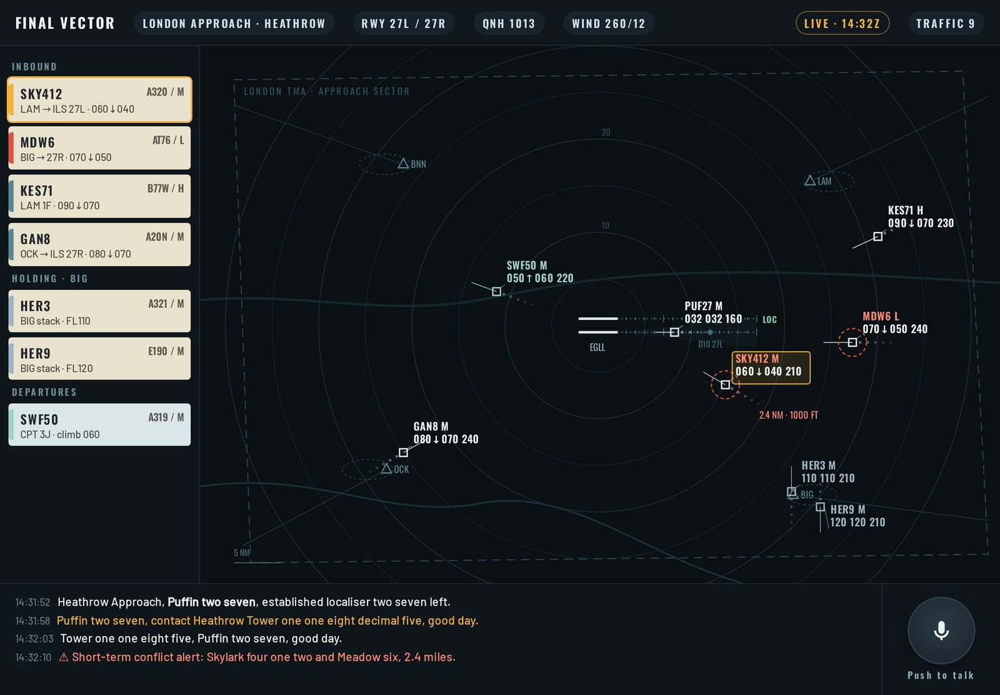
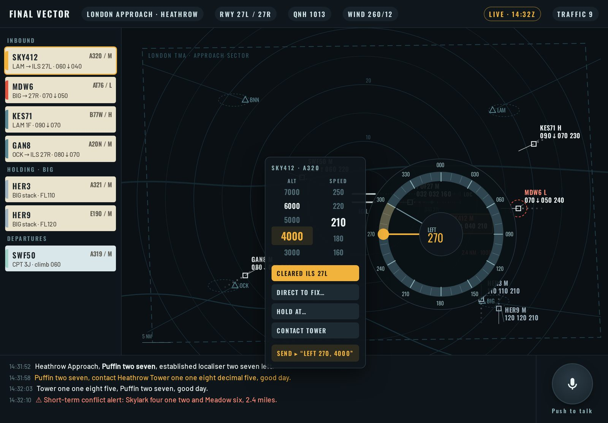
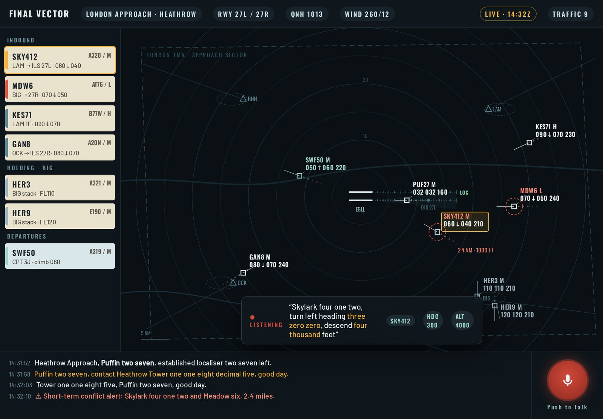
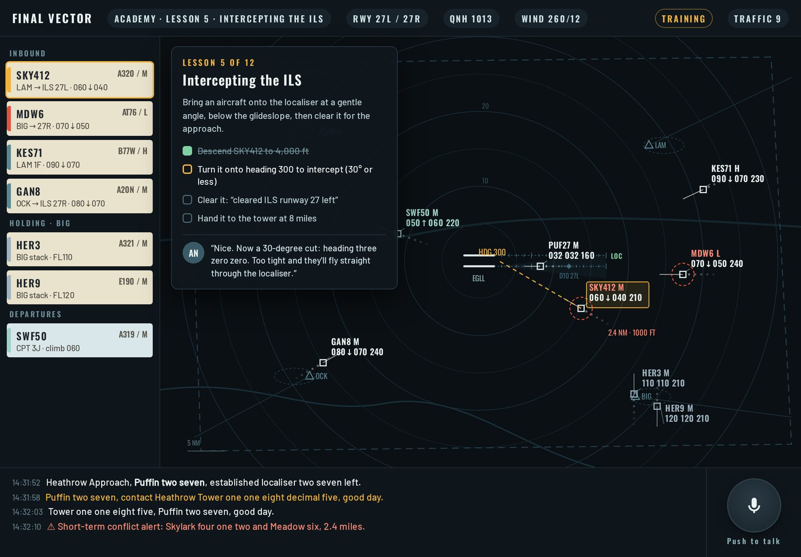

# Final Vector: concept

*Written 1 November 2026; decisions added the same day (section 12). A
concept, not yet a plan: work starts after Final Approach's Disruptions
part 2. Mockups are drawn to look like the real thing on an
iPad held sideways; the live mockup is [`img/mockup.html`](img/mockup.html)
(`?m=scope|dial|voice|lesson`). Day-to-day work (issues, releasing,
testing, the release log) is in [the runbook](RUNBOOK.md).*

## 1. The pitch

You're the approach controller at a busy airport. On a radar scope,
aircraft come down out of the holding stacks and you turn, descend and
slow them into a neat line on the approach, three miles apart, then hand
each one to the tower. You speak to them the way real controllers do,
by voice or with a command dial, and they read your instructions back.

It's a serious game for grown-ups, and it starts with a proper school:
air-traffic control is hard, so the Academy teaches it one idea at a
time, with an instructor in your ear, until you're ready for a real
shift.

**The name.** The *final vector* is the last heading a controller gives
to line an aircraft up on the approach: the moment the job is all about.
It pairs with *Final Approach*.

**How it relates to Final Approach.** Final Approach stays the family
game: one finger, a painted landscape, five-minute shifts. Final Vector
is its grown-up sibling in the Game Night hub. They share the hub, the
profiles and records, the radio voices and the airports' data, but not
the way you play. Final Approach can keep borrowing realism that fits
its style (real fix names, real airports in World Tour); Final Vector is
where the real procedures live.

## 2. Pillars

1. **Real, not realistic-looking.** Real separation (3 miles or 1,000
   feet), real phraseology, real aircraft performance (a heavy turns and
   slows like a heavy), real airports and procedures, simplified only
   where it doesn't change the job.
2. **Readable at a glance.** A modern scope, not a 1970s green screen:
   calm colours, clear data tags, conflicts that show before they happen.
3. **Taught, not thrown in.** Every idea is introduced in the Academy
   before it turns up in a live shift. No one should fail without knowing
   why.
4. **Talk like a controller.** Voice is a first-class way to play, with
   the command dial as a complete alternative. Pilots always read back.
5. **A shift has a story.** Each session ends with a debrief: a replay of
   the shift, what went well, every loss of separation with the moment you
   could have fixed it.

## 3. The job

You control the **approach**: the airspace around one airport, out to
about 40 miles, from the holding stacks down to the moment an aircraft
is established on the final approach.

- **Arrivals** come in along published routes (STARs) to the holding
  stacks. Real Heathrow has four: Bovingdon, Lambourne, Biggin and Ockham.
  You take them out of the stack in the right order and **vector** them:
  headings, altitudes and speeds that put them on the final approach
  course at a gentle angle, below the glideslope, three or more miles
  behind the one in front.
- **Cleared for the approach**, an aircraft flies the ILS itself; you hand
  it to the tower by eight miles out.
- **Departures** (later) climb out on their standard routes (SIDs); you
  climb them through the arrivals and hand them on to the next sector.
- **What goes wrong:** two aircraft closer than 3 miles and 1,000 feet (a
  *loss of separation*), an aircraft through the localiser or too high to
  intercept, a missed handoff, a busted altitude, and stacks that grow
  because you're too slow.

### The rules, as the game will hold them

| Rule | Real world | In the game |
|---|---|---|
| Separation | 3 nm horizontally or 1,000 ft vertically in the approach | Same. A ring shows 3 nm around a conflict; the alert warns about 60 s ahead |
| Wake turbulence | Bigger gaps behind heavier aircraft (L/M/H/J) | Same categories; 4–6 nm behind a heavy on final |
| ILS intercept | 30° or less, below the glideslope, about 10 nm out | Same; too steep and they fly through, too high and they can't capture |
| Speed | 250 kt below 10,000 ft; 160–180 kt on final | Same limits; each type has its own range |
| Performance | Turn rate ~3°/s; descent ~1,000–2,500 ft/min; slowing takes miles | Per type, simplified |
| Handoff | To the tower by about 8 nm | Same; late handoffs score badly |

## 4. The screen

- **The scope.** Range rings every 5 nm, the extended centrelines of the
  runways with a tick every mile, the localiser cone, holding stacks and
  their routes, the sector's edge. Each aircraft: its position, a short
  history trail, a speed vector line, and a **data tag**: callsign, wake
  category, current altitude, the altitude it's cleared to (with an arrow
  for climbing or descending), and ground speed. `SKY412 M / 060↓040 210`
  reads "Skylark 412, medium, at 6,000 ft descending to 4,000, 210 knots".
- **Strips** (left): one per aircraft, grouped Inbound, Holding and
  Departures, like the paper strips real controllers still use. The
  selected aircraft's strip is outlined; a red edge marks a conflict.
- **Radio log** (bottom): everything said, yours in amber, pilots' in
  white, alerts in red.
- **Push to talk** (bottom right): hold to speak.
- **Top bar:** the position, runways in use, pressure setting (QNH), wind,
  the clock and how many aircraft you have.
- In the mockup, Skylark 412 and Meadow 6 are 2.4 miles apart and only
  1,000 ft apart soon: the alert has fired, rings and tags turn red.

## 5. Giving instructions

**Three ways to give an instruction, all complete:** the command dial
(the default), voice, and on a laptop the keyboard. The dial is how
everyone starts; voice is switched on in Settings, and the Academy offers
it at lesson 10 (*Speaking like a controller*).

### The command dial

Tap an aircraft and a dial opens around it:

- **Heading:** drag round the ring. The arc shows which way it will turn
  (left or right is chosen by the shorter way, or by which side you drag).
- **Altitude and speed:** two scroll columns beside it, limited to what
  that aircraft can do.
- **Actions:** *Cleared ILS 27L* (offered only when it would work),
  *Direct to fix…*, *Hold at…*, *Contact tower*.
- **Send** shows the instruction in words before it goes ("Left 270,
  4000"), so it's always clear what you're about to say.

The pilot reads it back aloud, and the strip and tag update when they
start to comply (turning and descending take time, as they do).

### Voice

Hold *Push to talk* and speak as a controller would: "Skylark four one
two, turn left heading three zero zero, descend four thousand feet". The
panel shows what was heard, and below it the instruction as understood
(callsign, heading, altitude), then the pilot reads it back.

- **How it works:** the browser's own speech recognition (Safari on the
  iPad has it), then our own parser, which only has to understand
  controller phraseology and the callsigns actually on the scope. That
  narrow grammar is what makes it reliable: "three zero zero" can only be
  a heading after "heading", and "Skylark four one two" has to be one of
  the aircraft you can see.
- **When it isn't sure,** it asks, as a pilot would: "Say again for
  Skylark four one two?" Nothing is ever acted on unless it parsed
  completely; the dial is always there.
- **Phraseology counts** (optionally): saying it the proper way is scored
  in the debrief, and the Academy teaches it.
- **Readback errors, later:** now and then a pilot reads back the wrong
  altitude, as they do in real life, and you have to catch it ("Negative,
  descend four thousand"). It's one of the most real things about the
  job.

### The keyboard (laptop)

On a laptop, commands can be typed the way real systems take them, into
a command line under the scope:

- `SKY412 L270 D40 S210`: Skylark 412, left heading 270, descend 4,000
  ft, speed 210 knots. `R` turns right, `H` takes the shorter way, `C`
  climbs, `FL110` is a flight level.
- `SKY412 ILS27L`, `SKY412 HOLD BIG`, `SKY412 DCT LAM` (direct to a
  fix), `SKY412 TWR` (contact tower).
- Typing a callsign's first letters selects it (Tab completes), and
  clicking an aircraft fills its callsign in. Enter sends; the pilot reads
  back exactly as for the dial or voice. Up recalls the last command.
- The scope still works with the mouse (click for the dial); the keyboard
  is simply faster for keen players at a desk.

### Pilot voices

Readbacks have to say any callsign, heading, altitude and frequency, so
they can't be recorded line by line like Final Approach's. Instead each
pilot voice records the **pieces** once (digits, "heading", "flight
level", "descend", "cleared ILS runway", the callsign words, a few
greetings) and the game assembles them, with the radio filter we already
have smoothing the joins. Recorded with ElevenLabs like the rest: about
150 short clips per voice, around 1.5 MB for six voices, and no cost each
time a line is spoken. Live text-to-speech is a possible later upgrade
for unusual phrases.

## 6. The Academy

Each lesson is a short scenario with one idea, a task list, and an
instructor (Ann, a retired controller) who talks you through it and
comments on what you do. Hints draw on the scope (the dashed heading
line in the mockup) and fade as you get it. Lessons can be repeated; each
ends with a short check before the next opens.

| # | Lesson | You learn |
|---|---|---|
| 1 | Reading the scope | Data tags, strips, range rings, what's yours |
| 2 | Headings | Turning aircraft, which way they turn, how long it takes |
| 3 | Altitudes | Climb and descent, cleared levels, rates |
| 4 | Separation | 3 nm or 1,000 ft, the conflict alert, fixing one early |
| 5 | Intercepting the ILS | 30°, below the glideslope, cleared for the approach |
| 6 | Speed | Slowing down takes miles; speed for spacing |
| 7 | Two in a row | Sequencing: who goes first, spacing on final |
| 8 | The stacks | Holding, taking aircraft out in order, expected times |
| 9 | Wake turbulence | Bigger gaps behind heavies |
| 10 | Speaking like a controller | Phraseology, voice control, readbacks |
| 11 | Departures | Climbing out through the arrivals |
| 12 | When it goes wrong | Go-arounds, emergencies, a runway closing |
| ✓ | Checkride | A real shift at the training airport, assessed |

**The debrief** after every shift and lesson: a replay you can scrub
through, a timeline of what happened, each loss of separation with the
moment it became unavoidable and what would have fixed it, plus scores.

## 7. Pace and shifts

- **Real time,** with a **×2** button for quiet stretches (an aircraft
  crossing an empty sector). It drops back to real time by itself the
  moment a conflict alert fires, an aircraft calls, or anything needs you.
  The debrief notes how much of the shift ran at ×2; it doesn't affect the
  score.
- **A shift lasts about 20–30 minutes** at the chosen traffic level, and
  ends when the last scheduled arrival is handed to the tower.
- **Pause and resume:** a shift can be paused at any moment and picked up
  later on the same device, even after closing the app (the whole state
  is saved locally after every change). Academy lessons are short enough
  not to need it, but resume the same way.

## 8. Scoring and records

- **Safety** above everything: losses of separation, close calls, busted
  altitudes, aircraft through the localiser.
- **Efficiency:** delay in the stacks, track miles flown, how evenly
  spaced the arrivals were on final, fuel used.
- **Communication** (voice mode): how much was said the proper way.
- Records on the Game Night profile, like Final Approach's: Academy
  progress, your ratings per airport and traffic level, best shifts. The
  owner's Activity page covers it too.

## 9. Airports

1. **A training airport** (fictional), simple airspace: one runway, two
   stacks, light traffic. The whole Academy happens here.
2. **London Heathrow:** two parallel runways, four stacks, heavy
   traffic. The family's airport and the obvious showpiece.
3. **Thessaloniki** and **Paris Charles de Gaulle** after that, as in
   Final Approach's World Tour, then others.

Layouts come from OpenStreetMap (the importer planned for World Tour) and
from the published charts of each country's aeronautical information
(the stacks, routes and approaches), simplified where the detail doesn't
change the game. Traffic is invented; callsigns are never real airlines'.

## 10. The look

Dark slate, not black; calm cyan and white for traffic, amber for what's
yours, red only for conflicts. Oswald for tags and labels (shared with
Final Approach), Barlow for text. Strips on cream card like real paper
strips, the one warm thing on the screen. Everything sized for an iPad
held sideways first, a laptop second (with full keyboard control);
phones are a stretch (the scope needs room).

## 11. How it's built

- **A new game in the Game Night hub** (`games/final_vector/`), plain JS
  on a canvas like Final Approach, no build step.
- **Shared with Final Approach and the hub:** profiles, records, the
  Activity page, the audio pipeline (ElevenLabs, the radio filter, the
  queue), the OpenStreetMap importer, and the arrival-safety ideas.
- **Its own:** a simulation in real units (nautical miles, feet, knots)
  with per-type performance; the scope renderer; the dial; the speech
  parser and the keyboard command line (sharing one command grammar); the Academy's scripted lessons; the replay recorder for
  debriefs.

## 12. The first prototype

Small enough to tell whether it's fun before building the rest:

- The training airport, arrivals only, one runway.
- The scope, data tags and strips.
- The command dial: heading, altitude, speed, cleared ILS, contact tower.
- Separation and the conflict alert.
- Lessons 1 to 5 with the instructor's lines as text (voices later).
- Pilot readbacks from assembled clips for two voices.

**Done when:** someone new gets through lesson 5 and lands a stream of
four aircraft on the ILS without a loss of separation, and wants to do it
again.

Then: voice control, the rest of the Academy, stacks and sequencing,
Heathrow, departures, debrief replays, readback errors.

## 13. Decisions (1 November 2026)

| Question | Decision |
|---|---|
| Name | **Final Vector** |
| Pace | Real time, with ×2 for quiet stretches that drops back by itself when anything needs you |
| Default controls | The command dial; voice is optional (Settings, or from Academy lesson 10) |
| Laptops | Full keyboard control: a typed command line (`SKY412 L270 D40`) alongside the mouse and voice |
| Shift length | About 20–30 minutes, pausable and resumable later on the same device |
| When | After Final Approach's Disruptions part 2 (balloons, the air display, the cyber attack) |

## 14. Still open

- The training airport's name and layout.
- How much of real Heathrow's procedures to keep (every STAR and the
  stacks' real levels, or a simplified set).
- Whether departures come into the first full release or later.
